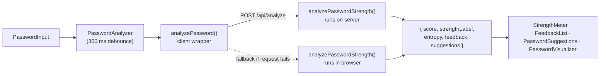

<div align="center">

# 🔐 Password Strength Analyzer

**Type a password, get an instant score, a plain-English explanation, and concrete ways to improve it.**


Network Security (NETSEC) course project

</div>

---

## TL;DR

```bash
git clone <repo-url> && cd NETSEC_PROJECT
npm install
npm run dev        # → http://localhost:3000
```

Everything interesting lives in **one file**: [`src/lib/password-analyzer.ts`](src/lib/password-analyzer.ts). If you only read one thing before changing the scoring, read that.

> ⚠️ **Demo/educational tool.** The password is sent to our own `/api/analyze` route. Never type a real password into a deployed copy. See [Security Notes](#-security-notes).

## 📑 Contents

- [What it does](#-what-it-does)
- [Getting started](#-getting-started)
- [Project structure](#-project-structure)
- [How scoring works](#-how-scoring-works)
- [Example scores](#-example-scores)
- [API reference](#-api-reference)
- [Known limitations](#-known-limitations)
- [Security notes](#-security-notes)
- [Contributing](#-contributing)
- [Troubleshooting](#-troubleshooting)
- [Ideas for next steps](#-ideas-for-next-steps)

## ✨ What it does

| Feature | Details |
| --- | --- |
| **Live analysis** | Re-scores as you type (300 ms debounce) with a loading spinner |
| **0–100 score** | Five labels: Very Weak → Very Strong, with a colour-coded animated meter |
| **Entropy estimate** | Shown in bits via the ⓘ tooltip next to the strength label |
| **Explainable results** | An *Analysis* list (✅ / ⚠️) says what was found; *Suggestions* says how to fix it |
| **Checks** | Length, character variety, common passwords, sequential patterns, repeated characters |
| **3D visualization** | Three.js shape, colour and particle count change with the score |
| **Show / hide** | Eye icon toggles the password text |

The 3D shape maps to the score band:

| Score | Label | Shape | Colour |
| --- | --- | --- | --- |
| 0–19 | Very Weak | Cube | Red |
| 20–39 | Weak | Sphere | Orange |
| 40–59 | Moderate | Torus | Yellow |
| 60–79 | Strong | Octahedron | Green |
| 80–100 | Very Strong | Dodecahedron | Emerald |

Particle count grows with password length (100 per character, up to 1000).

## 🚀 Getting started

### Prerequisites

- **Node.js 18.18+** (Next.js 15 requirement)
- **npm**. The repo ships a `package-lock.json`, so please stick with npm to avoid lockfile churn.
- **Internet on first run/build.** The Inter font is fetched from Google Fonts through `next/font/google`.
- A browser with **WebGL** for the 3D view.

### Install and run

```bash
npm install
npm run dev
```

Open <http://localhost:3000>. No environment variables are needed.

### Production build

```bash
npm run build
npm start
```

### Scripts

| Command | What it does |
| --- | --- |
| `npm run dev` | Dev server with Turbopack on port 3000 |
| `npm run build` | Production build |
| `npm start` | Serve the production build |
| `npm run lint` | ESLint (Next.js config) |

## 🗂 Project structure

```
.
├── public/                          # Static assets
└── src/
    ├── app/
    │   ├── api/analyze/route.ts     # POST /api/analyze (server-side analysis)
    │   ├── layout.tsx               # Root layout, metadata, Inter font
    │   ├── page.tsx                 # Home page
    │   └── globals.css
    ├── components/
    │   ├── password-analyzer.tsx    # Container: state, debounce, API call
    │   ├── password-input.tsx       # Input + show/hide + spinner
    │   ├── strength-meter.tsx       # Animated bar, label, entropy tooltip
    │   ├── feedback-list.tsx        # ✅ / ⚠️ analysis messages
    │   ├── password-suggestions.tsx # Improvement tips
    │   ├── password-visualizer.tsx  # Three.js scene
    │   └── ui/                      # button, card, input, tooltip (shadcn-style)
    └── lib/
        ├── password-analyzer.ts     # Scoring logic + client wrapper for the API
        ├── common-passwords.ts      # Common-password list
        └── utils.ts
```

**Where do I change…?**

| I want to… | Edit |
| --- | --- |
| Scoring, thresholds, messages | `src/lib/password-analyzer.ts` |
| Common-password list | `src/lib/common-passwords.ts` |
| Result UI (meter, lists) | matching file in `src/components/` |
| 3D scene | `src/components/password-visualizer.tsx` |
| API behaviour / validation | `src/app/api/analyze/route.ts` |

## 🧮 How scoring works



The score is the sum of three capped components, minus penalties, clamped to 0–100.

| Component | Formula | Max |
| --- | --- | --- |
| Length | `length × 2.5` | 30 (reached at 12 chars) |
| Character variety | `types used × 7.5` (lower, upper, digit, symbol) | 30 |
| Entropy | `entropy ÷ 4` | 30 |

| Penalty | Points |
| --- | --- |
| Exact match in common-password list (case-insensitive) | −30 |
| Contains a 3-character sequence (`abc`, `123`, `qwe`, `asd`, `zxc`…) | −15 |
| Contains 3+ identical characters in a row | −15 |

Because each component is capped at 30, **the highest possible score is 90.**

<details>
<summary><strong>Entropy details</strong></summary>

Entropy is `length × log2(pool size)`, where the pool adds 26 for lowercase, 26 for uppercase, 10 for digits and 33 for symbols, once per type present. The code comments call this "Shannon entropy", but it is a pool-size estimate that assumes every character is chosen at random. It is useful for comparing passwords of the same style, not as a true guessability measure.

</details>

## 🧪 Example scores

Produced by running the actual `analyzePasswordStrength()` from this repo:

| Password | Score | Label | Entropy (bits) |
| --- | --- | --- | --- |
| `password` | 7 | Very Weak | 37.6 |
| `qwerty123` | 4 | Very Weak | 46.5 |
| `abc12345` | 30 | Weak | 41.4 |
| `P@ssw0rd` | 63 | Strong | 52.6 |
| `correcthorsebatterystaple` | 67 | Strong | 117.5 |
| `aaaBBB111!!!` | 65 | Strong | 78.8 |
| `Summer2024!` | 76 | Strong | 72.3 |
| `X7#kQ9!vLm2$` | 80 | Very Strong | 78.8 |
| `Gx9$mT2#pLq8Zw` | 83 | Very Strong | 92.0 |

Note that `P@ssw0rd`, `aaaBBB111!!!` and `Summer2024!` all rate **Strong** even though they are very guessable. That is the main gap in the current logic; see below.

## 📡 API reference

### `POST /api/analyze`

**Request**

```json
{ "password": "string" }
```

**Response `200`**

```json
{
  "score": 62,
  "strengthLabel": "Strong",
  "entropy": 78.6,
  "feedback": [
    { "type": "success", "message": "Good password length" },
    { "type": "warning", "message": "Contains repeated characters" }
  ],
  "suggestions": ["Avoid repeating the same character multiple times"]
}
```

**Errors**

| Status | Body | Cause |
| --- | --- | --- |
| 400 | `{ "error": "Password is required" }` | Missing or empty `password` |
| 500 | `{ "error": "Failed to analyze password" }` | Unhandled error, e.g. invalid JSON body |

Quick test:

```bash
curl -s -X POST http://localhost:3000/api/analyze \
  -H "Content-Type: application/json" \
  -d '{"password":"abc12345"}'
```

## ⚠️ Known limitations

Please read before relying on, or extending, the scoring:

- **Small common-password list.** About 60 entries, exact match only (lowercased). `password` is caught; `Password1!` and `P@ssw0rd` are not.
- **Entropy is optimistic.** Human-chosen patterns like `Summer2024!` score far higher than their real guessability.
- **Basic pattern detection.** Only forward 3-character runs from the alphabet, digits and three keyboard rows. No reversed runs (`cba`), other keyboard walks, leetspeak, dates or dictionary words.
- **Repeats are only a penalty.** `aaaBBB111!!!` still reaches Strong.
- **Max score is 90**, although labels reserve 80–100 for Very Strong.
- **Thresholds are duplicated** in `password-analyzer.ts`, `strength-meter.tsx` and `password-visualizer.tsx`. Change them together, or consolidate into one shared helper.
- **No automated tests.**

## 🛡 Security notes

- **The raw password is POSTed to the server.** Fine for local development and a course demo. For any real deployment, serve over HTTPS, never log request bodies, and consider running the analysis fully client-side (the fallback already exists).
- **Do not enter real passwords** while demoing or testing.
- The endpoint has **no rate limiting or authentication**.
- The app does not store or log passwords; the only `console.error` calls print caught errors.
- The input uses `autoComplete="new-password"` so browsers don't offer saved credentials.

## 🤝 Contributing

1. Branch from `main`: `git checkout -b feature/short-description`
2. Make your change, then run `npm run lint` and `npm run build`.
3. Scoring changes affect every result, so explain the reasoning in the PR and update the [Example scores](#-example-scores) table if values shift.
4. Update this README when behaviour, scoring or the API changes.

**Conventions**

- Function components in `src/components`, files named `kebab-case.tsx`.
- Use the `@/` alias for imports under `src/`.
- Anything using hooks, Framer Motion or Three.js needs `"use client"` at the top.

## 🧰 Troubleshooting

| Problem | Fix |
| --- | --- |
| Build fails fetching the Inter font | You're offline or Google Fonts is blocked. Connect, or swap `next/font/google` for a local font in `layout.tsx`. |
| `Unsupported engine` / syntax errors on install | Upgrade to Node 18.18 or newer. |
| 3D view is blank | WebGL is disabled or unsupported; enable hardware acceleration in the browser. |
| Port 3000 already in use | `npm run dev -- -p 3001` |

## 💡 Ideas for next steps

Suggestions for the team, not committed work:

- Replace the hand-rolled checks with a library such as [`zxcvbn`](https://github.com/dropbox/zxcvbn), or at least expand the common-password list and match normalised variants (leetspeak, trailing digits).
- Move analysis client-side so the password never leaves the browser.
- Extract score → label/colour into one shared module.
- Add unit tests for `analyzePasswordStrength()` using the example table above.
- Add a "Have I Been Pwned" k-anonymity breach check.
